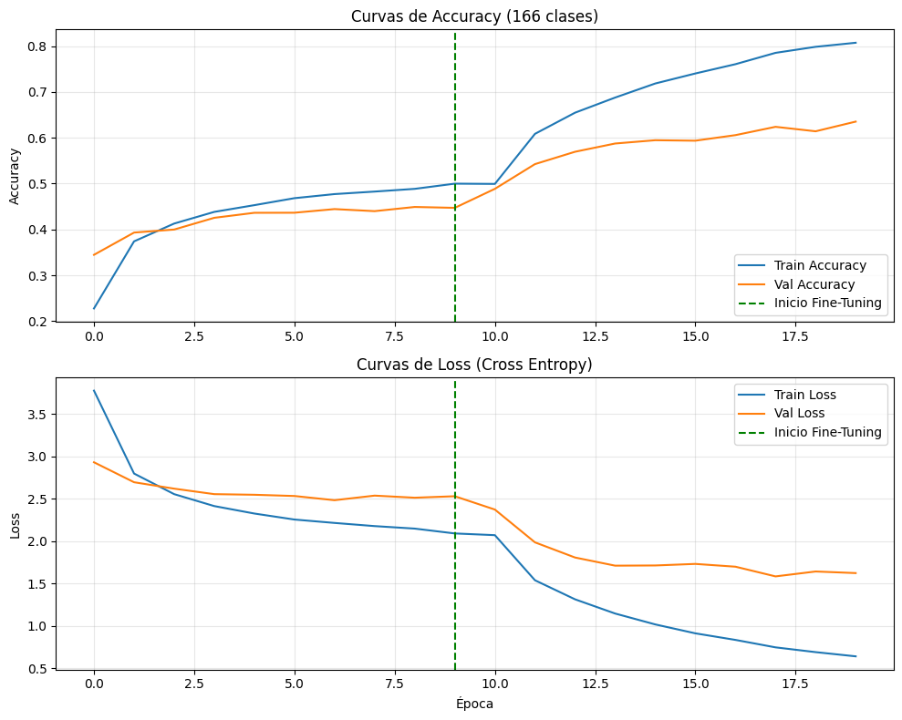
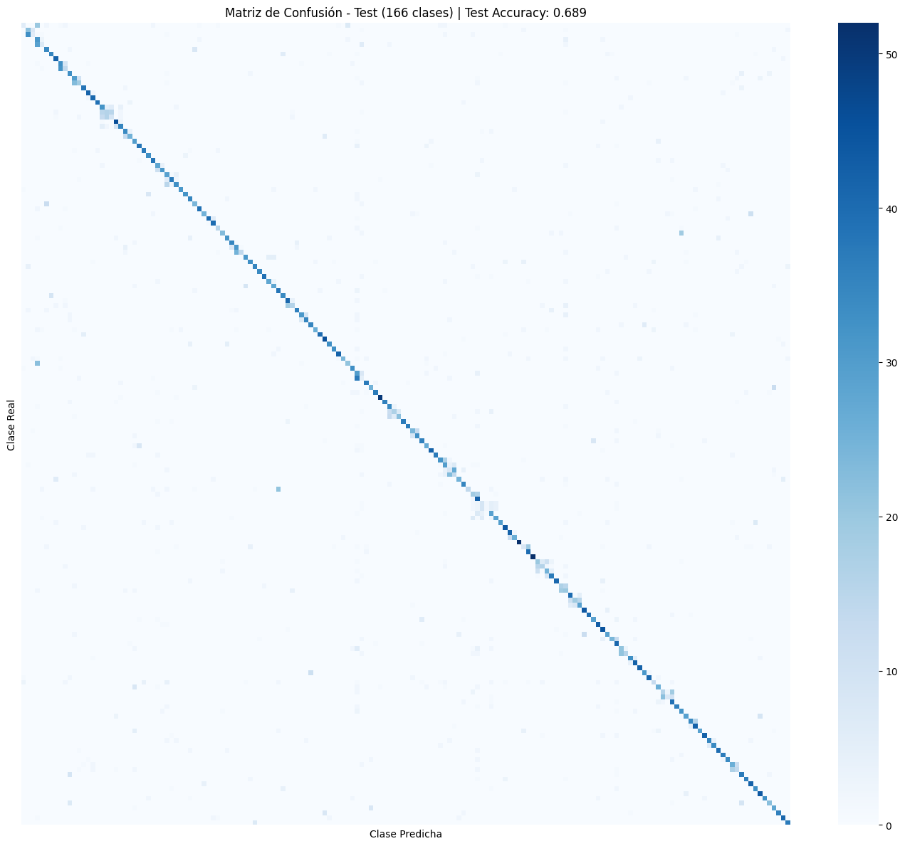

# Clasificador de Pokémon con Transfer Learning

Este proyecto utiliza transferencia de aprendizaje (Transfer Learning) con la red MobileNetV2 para clasificar imágenes de Pokémon de la primera generación (166 clases, incluyendo megaevoluciones), entrenado a partir del dataset de Kaggle (mornville/pokemonimagedataset).

---

## Entregables del proyecto

A continuación se presentan todas las evidencias requeridas para la entrega del proyecto:

1. **Archivo fuente Python:**
   - [pokemon_transfer_learning.py](pokemon_transfer_learning.py): Script autónomo para entrenamiento, evaluación y exportación del modelo.
   - [Transfer_Learning_Pokemon.ipynb](Transfer_Learning_Pokemon.ipynb): Libreta interactiva paso a paso para Google Colab.

2. **Archivo SLRM:**
   - [script.slrm](script.slrm): Archivo de configuración para YUCA.

3. **Gráfica de accuracy y loss, y matriz de confusión:**
   - **Curvas de Precisión y Pérdida (Accuracy / Loss):**
     
     

   - **Matriz de Confusión:**
     
     

4. **Liga al artículo de Medium:**
   - [Artículo en Medium: Clasificación de 166 Pokémon mediante Transfer Learning](https://medium.com/@lanfaro2727/clasificaci%C3%B3n-y-detecci%C3%B3n-de-pok%C3%A9mon-mediante-redes-neuronales-convolucionales-y-transferencia-de-29d89663d94e)
  
5. **Liga al proyecto en GitHub:**
   - https://github.com/Ricardo050427/Transfer-Learning

6. **Video utilizando la aplicación en celular:**
   - [Video demostrativo en celular (pokedex.mp4)](pokedex.mp4): Grabación en video probando la Pokédex web en tiempo real desde el dispositivo móvil.

7. **Archivo de ambiente Conda configurado:**
   - [environment.yml](environment.yml): Especificación de dependencias del entorno `pokemon_env` reproducible.

---

## Estructura del repositorio

- `Transfer_Learning_Pokemon.ipynb`: Libreta interactiva paso a paso para Google Colab.
- `pokemon_transfer_learning.py`: Script de entrenamiento en Python para ejecución autónoma.
- `script.slrm`: Archivo de configuración para el gestor de trabajos SLURM en el clúster YUCA.
- `environment.yml`: Archivo de configuración del entorno reproducible Conda.
- `pokedex.mp4`: Video de demostración utilizando la aplicación web desde el teléfono celular.
- `grafica_acc_loss_pokemon.png`: Gráfica oficial de curvas de precisión y pérdida (accuracy y loss).
- `matriz_confusion_pokemon.png`: Gráfica oficial de matriz de confusión (166 clases).
- `imagenes/`: Carpeta con todas las figuras generadas durante el entrenamiento y la portada.
- `articulo_medium.md`: Artículo redactado completamente en español en formato Markdown.
- `pokedex_web/`: Aplicación web interactiva estilo Pokédex pixel art de 8 bits.
- `pokedex_netlify.zip`: Archivo comprimido listo para desplegar en Netlify.
- `modelo_web_pokemon/`: Archivos del modelo exportados para inferencia web y móvil.

---

## Cómo ejecutar el entrenamiento

### YUCA
1. Crear y activar el entorno Conda:
   ```bash
   conda env create -f environment.yml
   source activate pokemon_env
   ```
2. SLURM:
   ```bash
   sbatch script.slrm
   ```
3. Revisar el estado del trabajo:
   ```bash
   squeue -u $USER
   tail -f salida_pokemon_*.log
   ```

---

## Aplicación Web (Pokédex)

Para probar el modelo interactivamente en computadora o celular:
https://euphonious-rabanadas-956233.netlify.app/
