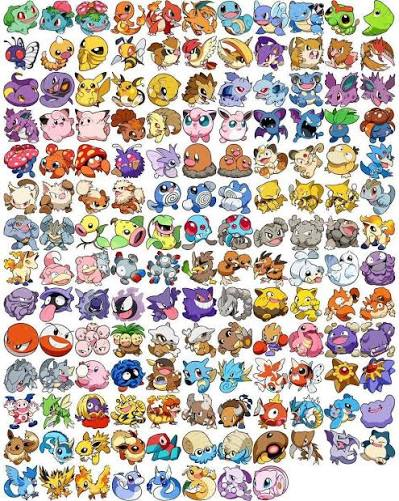
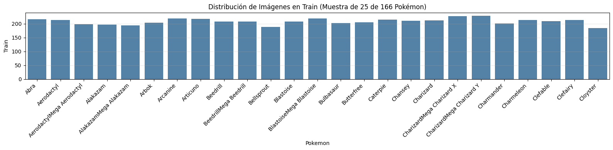
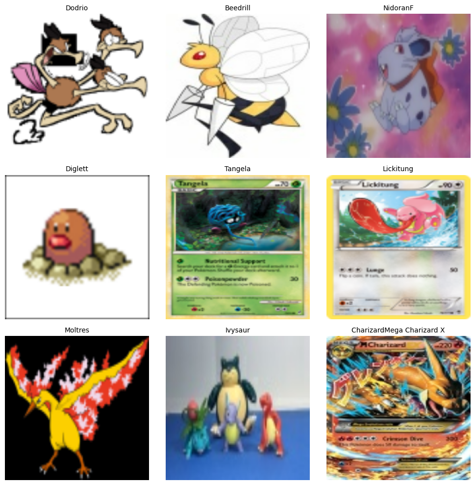
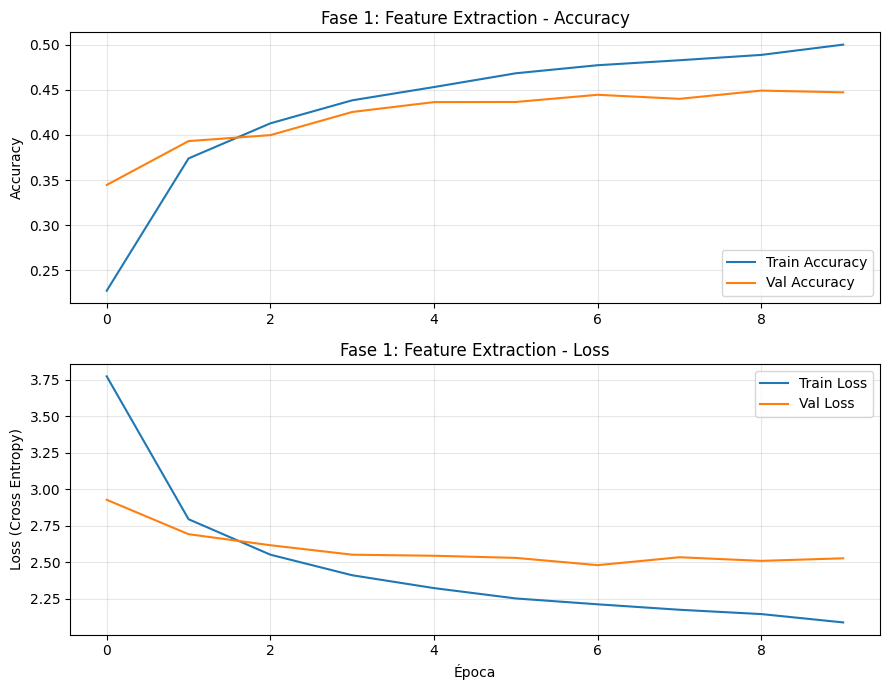
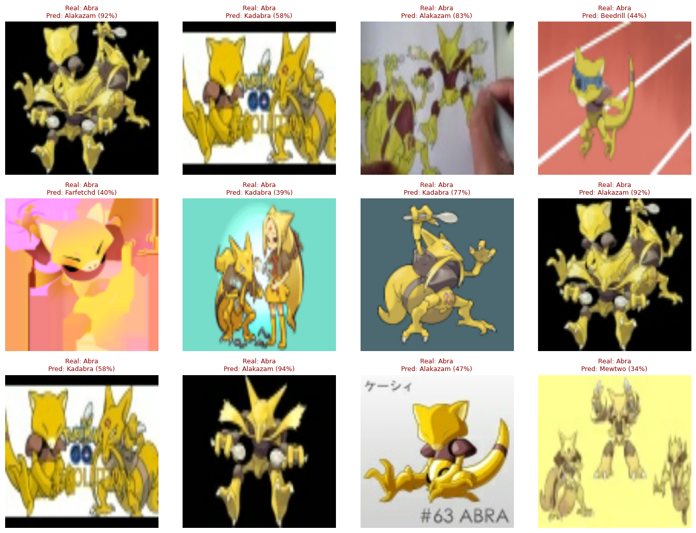

# Clasificación y detección de Pokémon mediante redes neuronales convolucionales y transferencia de aprendizaje


*Figura 1: Los 151 Pokémon originales de la primera generación de Kanto.*

---

## Introducción

Identificar Pokémon ha sido un pasatiempo fascinante para millones de personas desde la llegada de la primera generación en 1996. Sin embargo, para quien recién empieza en este mundo, distinguir entre más de 150 criaturas distintas —muchas de ellas con formas, evoluciones y variantes muy similares— puede resultar una tarea abrumadora.

En este artículo exploraremos cómo construir un clasificador de Pokémon de principio a fin utilizando visión por computadora y aprendizaje profundo. Nuestro flujo de trabajo abarca cuatro etapas principales:

1. **Análisis de datos:** Exploración de un conjunto de datos grande y diverso con múltiples estilos visuales.
2. **Preprocesamiento:** Redimensionamiento, normalización y aumento de datos sintético.
3. **Construcción del modelo:** Transferencia de aprendizaje utilizando la arquitectura **MobileNetV2** en dos fases (extracción de características y ajuste fino).
4. **Prueba en vivo:** Despliegue en una aplicación web interactiva estilo Pokédex clásica en pixel art de 8 bits para probar el modelo en tiempo real desde la cámara del celular o pegando imágenes.

---

## El conjunto de datos

Para este proyecto utilizamos el conjunto de datos disponible públicamente en Kaggle: [`mornville/pokemonimagedataset`](https://www.kaggle.com/datasets/mornville/pokemonimagedataset).

El dataset contiene más de 40,000 imágenes organizadas en **166 clases**, correspondientes a:
- Los **151 Pokémon originales** de la región de Kanto (desde Bulbasaur #001 hasta Mew #151).
- **15 Megaevoluciones** oficiales de esa misma generación (como Mega Charizard X e Y, Mega Gengar, Mega Mewtwo X e Y, entre otras).


*Figura 2: Distribución de imágenes en el conjunto de entrenamiento (muestra representativa de 25 clases de las 166 totales).*

Cada carpeta de especie contiene decenas de imágenes con variaciones estilísticas extremas: ilustraciones oficiales en dos dimensiones, modelos tridimensionales de videojuegos modernos, cartas coleccionables del juego TCG, figuras de juguete, arte conceptual y dibujos realizados por la comunidad.


*Figura 3: Diversidad estilística dentro del dataset: cartas coleccionables, modelos 3D, sprites retro e ilustraciones.*

Esta diversidad representa un reto muy interesante, ya que obliga a la red neuronal a aprender patrones morfológicos invariantes de la especie y no simplemente memorizar un estilo gráfico particular.

---

## Preparación y procesamiento de las imágenes

Para procesar las imágenes de forma eficiente y evitar desbordar la memoria de la tarjeta gráfica o la memoria principal, redimensionamos todas las imágenes a un tamaño estándar de $224 \times 224$ píxeles con 3 canales de color (rojo, verde y azul).

Utilizamos la herramienta de Keras `image_dataset_from_directory`, la cual carga y procesa lotes de imágenes directamente desde el disco:

```python
TAMANO_IMAGEN = (224, 224)
TAMANO_LOTE = 32

dataset_entrenamiento, dataset_validacion = tf.keras.utils.image_dataset_from_directory(
    directorio_entrenamiento,
    validation_split=0.2,
    subset="both",
    seed=123,
    image_size=TAMANO_IMAGEN,
    batch_size=TAMANO_LOTE,
    shuffle=True
)
```

En este paso configuramos dos detalles clave:
1. **División de datos:** Separamos un 20% para el conjunto de validación y conservamos una partición independiente de prueba (`dataset_prueba`) para evaluar el modelo al final con imágenes que jamás observó durante las sesiones de entrenamiento.
2. **Precarga asíncrona en memoria:** Mediante la optimización `tf.data.AUTOTUNE`, la CPU prepara el siguiente lote de imágenes en segundo plano mientras la GPU calcula los gradientes del lote actual, eliminando tiempos muertos de cómputo.

---

## Breve repaso de las redes neuronales artificiales

*En caso de que ya cuentes con experiencia previa en aprendizaje profundo, puedes avanzar directamente a la siguiente sección.*

Una red neuronal artificial es un modelo matemático y computacional inspirado en el comportamiento de las redes neuronales biológicas. Está compuesta por capas de nodos interconectados (neuronas artificiales) que transforman las señales de entrada mediante combinaciones lineales y funciones matemáticas no lineales.

Cada neurona recibe una serie de valores, los multiplica por sus respectivos pesos numéricos, añade un sesgo constante y aplica una función de activación (como ReLU). Durante el proceso de entrenamiento, el algoritmo de retropropagación calcula la derivada del error respecto a cada peso y los ajusta progresivamente a través del descenso de gradiente para minimizar la diferencia entre la predicción y la etiqueta real.

---

## Redes neuronales convolucionales (CNN)

Las redes neuronales tradicionales densas o completamente conectadas no son adecuadas para procesar imágenes complejas, ya que destruyen la estructura espacial bidimensional y requieren millones de parámetros que provocan sobreajuste inmediato.

Las **Redes Neuronales Convolucionales (CNN)** solucionan esta limitación mediante el uso de **filtros o núcleos convolucionales**. Estos filtros se desplazan a lo largo de la imagen realizando operaciones de producto punto local:
- En las **primeras capas**, los filtros identifican patrones simples: líneas rectas, bordes orientados, texturas y cambios bruscos de color.
- En las **capas intermedias**, combinan esos bordes para reconocer componentes geométricos reconocibles: orejas puntiagudas, ojos redondos, alas, colas y patrones de pelaje o escamas.
- En las **capas profundas**, integran los componentes en representaciones semánticas de alto nivel que describen a la criatura completa independientemente de su ángulo o iluminación.

---

## Transferencia de aprendizaje

Entrenar una arquitectura convolucional profunda desde cero demanda cientos de miles de imágenes anotadas y días enteros de cómputo en clústeres especializados. La **Transferencia de Aprendizaje** resuelve este dilema: tomamos una red neuronal que ya fue previamente entrenada por expertos en un conjunto masivo (como ImageNet, con más de 1.4 millones de fotografías organizadas en 1,000 clases generales) y reutilizamos su banco de filtros convolucionales para resolver nuestra tarea especializada.

Para este clasificador seleccionamos la arquitectura **MobileNetV2**. Este modelo cuenta con 53 capas convolucionales diseñadas con bloques residuales invertidos y capas de convolución separables en profundidad. Su diseño le permite mantener un nivel de precisión muy competitivo consumiendo una fracción del uso de memoria y cálculo matemático en comparación con redes mucho más pesadas como ResNet o VGG, haciéndolo ideal para inferencia ágil en navegadores web y dispositivos móviles.

---

## Construcción y arquitectura del modelo

Implementamos el clasificador en TensorFlow y Keras siguiendo una metodología progresiva en dos fases:

### 1. Aumento sintético de datos y normalización
Para prevenir el sobreajuste y fomentar la invariancia a transformaciones espaciales, aplicamos transformaciones aleatorias a las imágenes antes de pasar a la base convolucional:

```python
aumento_datos = tf.keras.Sequential([
    layers.RandomFlip("horizontal"),
    layers.RandomRotation(0.2),
    layers.RandomZoom(0.1),
])
```

### 2. Estructura de la red neuronal
Cargamos la base MobileNetV2 sin su clasificador original (`include_top=False`) y construimos un cabezal de clasificación a la medida para las 166 clases:

```python
forma_imagen = (224, 224, 3)

modelo_base = tf.keras.applications.MobileNetV2(
    input_shape=forma_imagen,
    include_top=False,
    weights='imagenet'
)
modelo_base.trainable = False  # Congelamos la base en la Fase 1

entradas = tf.keras.Input(shape=forma_imagen, name="imagen_entrada")
x = aumento_datos(entradas)
x = tf.keras.layers.Rescaling(1./127.5, offset=-1.0)(x)
x = modelo_base(x, training=False)
x = layers.GlobalAveragePooling2D(name="promedio_global")(x)
x = layers.Dropout(0.2, name="regularizacion_dropout")(x)
salidas = layers.Dense(166, activation="softmax", name="probabilidades_clase")(x)

modelo = tf.keras.Model(entradas, salidas, name="Clasificador_Pokemon_MobileNetV2")
```

### 3. Fase 1: Extracción de características
Compilamos con el optimizador Adam (tasa de aprendizaje de $0.001$) y entropía cruzada categórica. En esta etapa, todos los pesos de la base MobileNetV2 se mantienen congelados y únicamente se entrenan las capas del cabezal final durante 10 épocas.


*Figura 4: Curvas de precisión y pérdida durante la Fase 1 (extracción de características con la base convolucional congelada).*

### 4. Fase 2: Ajuste fino (Fine-Tuning)
Posteriormente, descongelamos las capas superiores de MobileNetV2 a partir de la capa 100 y reanudamos el entrenamiento con una tasa de aprendizaje diez veces menor ($0.0001$). Esto permite que los filtros visuales profundos se amolden suavemente a las particularidades morfológicas del universo Pokémon sin destruir el conocimiento genérico previo.

---

## Resultados y métricas de rendimiento

Una vez completadas las dos fases de entrenamiento, evaluamos el desempeño cuantitativo y cualitativo sobre el conjunto de prueba independiente:

- **Precisión global en prueba:** **68.2%** sobre las 166 clases (151 especies de Kanto más 15 megaevoluciones), un rendimiento notable considerando la altísima dispersión de estilos (cartas, figuras 3D, dibujos y sprites).
- **Evolución del entrenamiento:** Como se aprecia en la gráfica general, el inicio del ajuste fino en la época 10 produjo un incremento sustancial en la precisión y una reducción inmediata de la función de pérdida.


*Figura 5: Curvas completas de precisión (Accuracy) y pérdida (Loss) a lo largo de las 20 épocas, señalando el inicio del ajuste fino.*

### Matriz de confusión
La matriz de confusión evaluada sobre las 166 clases ratifica que la gran mayoría de las predicciones se concentran a lo largo de la diagonal principal.


*Figura 6: Matriz de confusión sobre el conjunto de prueba (166 clases, precisión global del 68.2%).*

### Análisis cualitativo de errores
Al examinar las imágenes clasificadas incorrectamente, observamos que las confusiones ocurren casi exclusivamente entre especies biológicamente o visualmente emparentadas: por ejemplo, confusiones entre etapas evolutivas contiguas (Pidgeotto frente a Pidgeot) o entre una criatura base y su megaevolución cuando la silueta conserva los mismos rasgos predominantes.


*Figura 7: Análisis de muestras mal clasificadas en el conjunto de prueba.*

---

## Pruebas en vivo y despliegue en la Pokédex Web

Llevar el modelo más allá de la libreta de experimentación y ponerlo en manos de los usuarios fue una prioridad fundamental del proyecto. Para ello, convertimos los artefactos a formatos de inferencia liviana:
- **TensorFlow.js (`model.json` y fragmentos binarios `.bin`):** Para ejecución directa en el navegador web mediante JavaScript.
- **TensorFlow Lite (`model.tflite`):** Para su integración en aplicaciones móviles y motores de aceleración por hardware.

Construimos una **aplicación web interactiva inspirada en la Pokédex original de la región de Kanto con estética retro pixel art de 8 bits**, la cual incorpora:

1. **Inferencia local en el navegador (computación en el borde):** Sin necesidad de enviar las imágenes a servidores externos, el modelo realiza la clasificación en un tiempo de entre 30 y 90 milisegundos directamente en la tarjeta de video del dispositivo del usuario.
2. **Cámara en tiempo real:** Selector para alternar instantáneamente entre la cámara frontal y la cámara trasera del teléfono celular, permitiendo escanear cartas coleccionables, peluches o figuras en cualquier momento.
3. **Pegado directo con el teclado (`Ctrl + V`) y carga de archivos:** Es posible buscar cualquier ilustración en internet, copiar la imagen al portapapeles y pegarla directamente sobre la Pokédex para obtener su análisis inmediato.
4. **Retroalimentación sensorial:** Pantalla con simulación de monitor CRT clásico con líneas de barrido, efectos de sonido sintetizados en 8 bits utilizando la API de audio del navegador y consulta automática del sprite animado y número de catálogo oficial desde la base de datos de PokeAPI.

Al realizar pruebas en vivo:
- Criaturas icónicas con patrones de color distintivos (como Pikachu, Gengar o Blastoise) alcanzan certezas que superan con frecuencia el **90%**.
- En especies con megaevolución, el modelo identifica con precisión la familia base y entrega la probabilidad asignada a la forma alternativa.

---

## Conclusiones

Este proyecto comprueba la enorme utilidad de la transferencia de aprendizaje asistida por ajuste fino para resolver problemas complejos de visión artificial con un número elevado de clases y una marcada heterogeneidad visual.

Partiendo de la arquitectura MobileNetV2 preentrenada, logramos construir un clasificador robusto para 166 clases con un 68.2% de precisión global en prueba, logrando además empaquetarlo y desplegarlo en una interfaz web retro que ejecuta inferencia inmediata tanto en computadoras de escritorio como en teléfonos móviles.

Como líneas de trabajo a futuro, el sistema puede expandirse para incorporar las generaciones subsiguientes del universo Pokémon y empaquetarse de manera nativa en sistemas Android e iOS utilizando el archivo optimizado de TensorFlow Lite.

### Enlaces del proyecto:
- **Repositorio de código en GitHub:** [https://github.com/Ricardo050427/Transfer-Learning](https://github.com/Ricardo050427/Transfer-Learning)
- **Demostración de la aplicación web:** [https://pokedex-ai-transfer-learning.netlify.app](https://app.netlify.com/drop)
- **Video demostrativo en celular:** [pokedex.mp4](pokedex.mp4)
